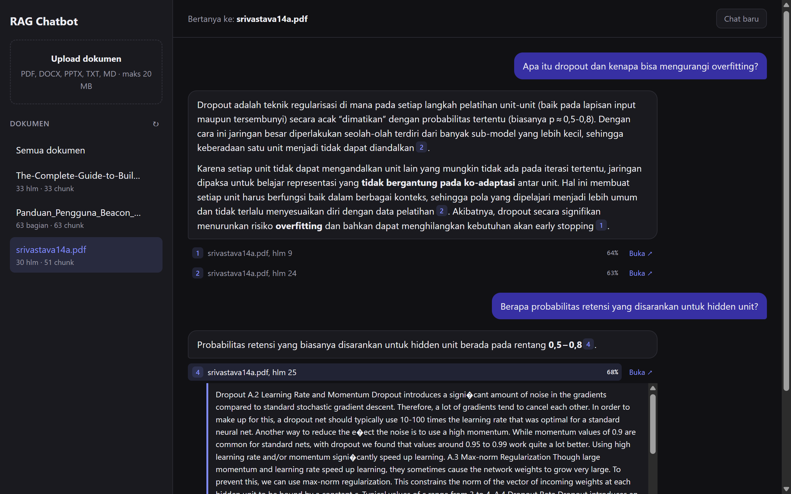

# RAG Chatbot

Chatbot tanya-jawab berbasis dokumen PDF. Upload PDF, lalu tanyakan isinya. Jawaban
di-stream token demi token dan menyertakan sitasi `[n]` yang merujuk ke halaman sumber.

Arsitektur hybrid: vector DB dan embedding jalan self-hosted (Docker), sedangkan LLM
memakai API cloud yang OpenAI-compatible (default: Groq), jadi mudah diganti.



## Arsitektur

```
[ Vite + React SPA ] ──/api──> [ Go API (net/http) ]
                                        │
               ┌────────────────────────┼────────────────────────┐
               │                        │                        │
          [ Qdrant ]               [ Ollama ]               [ Groq API ]
          vector DB         nomic-embed-text (768d)     openai/gpt-oss-120b
```

**Ingest** (`POST /ingest`): PDF → ekstrak teks per halaman → chunk ±375 kata
(overlap 40, tidak melewati batas halaman) → embedding via Ollama (batch 32) →
upsert ke collection Qdrant `chunks`. Kalau gagal di tengah jalan, point yang sudah
masuk dihapus lagi, jadi dokumen tidak pernah setengah terindeks.

**Chat** (`POST /chat`): pertanyaan → embedding → similarity search top-5 di Qdrant
(opsional difilter per dokumen) → filter skor relevansi → prompt dengan konteks
bernomor → Groq (streaming) → Server-Sent Events ke browser: `token`… lalu `sources`,
lalu `done`. Kalau tidak ada chunk yang lolos filter, API langsung menjawab "tidak
ditemukan" tanpa memanggil LLM.

## Stack

| Lapisan   | Teknologi |
|-----------|-----------|
| Frontend  | Vite + React + TypeScript |
| Backend   | Go, stdlib `net/http` (tanpa framework) |
| Vector DB | Qdrant (REST API) |
| Embedding | Ollama `nomic-embed-text` |
| LLM       | Groq, endpoint OpenAI-compatible `/chat/completions` |
| PDF       | `github.com/ledongthuc/pdf` |

## Menjalankan secara lokal

Prasyarat: Go 1.22+, Node.js 20+, Docker.

1. Jalankan Qdrant dan Ollama, lalu pull model embedding:

   ```bash
   docker compose up -d
   docker compose exec ollama ollama pull nomic-embed-text
   ```

   Dashboard Qdrant tersedia di http://localhost:6333/dashboard.

2. Siapkan environment variable:

   ```bash
   cp .env.example .env
   ```

   Isi `GROQ_API_KEY` di `.env` (buat key di https://console.groq.com). File `.env`
   sudah di-`.gitignore`, jangan pernah di-commit.

3. Jalankan API (port 8080):

   ```bash
   go run ./cmd/api
   ```

4. Jalankan frontend (port 5173). Vite mem-proxy `/api/*` ke `localhost:8080`:

   ```bash
   cd web
   npm install
   npm run dev
   ```

5. Buka http://localhost:5173, upload PDF, lalu mulai bertanya.

### Environment variable

| Nama             | Default                          | Keterangan |
|------------------|----------------------------------|------------|
| `GROQ_API_KEY`   | —                                | Wajib untuk `/chat` |
| `GROQ_MODEL`     | `openai/gpt-oss-120b`            | Model apa pun yang tersedia di akun Groq |
| `LLM_BASE_URL`   | `https://api.groq.com/openai/v1` | Ganti untuk provider OpenAI-compatible lain |
| `OLLAMA_URL`     | `http://localhost:11434`         | |
| `EMBED_MODEL`    | `nomic-embed-text`               | Model lain wajib berdimensi 768, atau ubah `embed.Dimension` |
| `QDRANT_URL`     | `http://localhost:6333`          | |
| `QDRANT_API_KEY` | kosong                           | Isi jika Qdrant memakai autentikasi |
| `MIN_SCORE`      | `0.64`                           | Skor cosine minimum agar chunk dipakai; `0` = mati |
| `SCORE_MARGIN`   | `0.10`                           | Buang chunk yang skornya lebih dari ini di bawah hit teratas; `0` = mati |
| `PORT`           | `8080`                           | |

`.env` hanya dibaca untuk development lokal. Variable yang sudah di-set di environment
selalu menang, jadi di production cukup set lewat systemd, Docker, atau sejenisnya.

## API

| Method   | Path              | Keterangan |
|----------|-------------------|------------|
| `GET`    | `/health`         | Health check |
| `POST`   | `/ingest`         | Multipart field `file` (PDF, maks 20 MB) → `{document_id, filename, pages, chunks}` |
| `POST`   | `/chat`           | `{question, document_id?}` → stream SSE |
| `GET`    | `/documents`      | Daftar dokumen, terbaru dulu |
| `DELETE` | `/documents/{id}` | Hapus dokumen beserta semua chunk-nya (`204`, atau `404` jika tidak ada) |

Event SSE dari `/chat`:

```
event: token    data: {"text":"..."}          (berulang)
event: sources  data: [{document_id, filename, page, chunk_index, score, text}, ...]
event: done     data: {}
event: error    data: {"error":"..."}         (pengganti done jika gagal di tengah stream)
```

Contoh dengan curl:

```bash
curl -F file=@dokumen.pdf localhost:8080/ingest
curl -N -H 'Content-Type: application/json' -d '{"question":"Apa isi bab 1?"}' localhost:8080/chat
```

## Struktur project

```
rag-chatbot/
├── cmd/api/main.go        # entrypoint, wiring dependency, loader .env
├── internal/
│   ├── handler/           # HTTP: /ingest, /chat (SSE), /documents
│   ├── rag/               # chunking + prompt builder
│   ├── pdftext/           # ekstraksi teks PDF per halaman
│   ├── vector/            # client REST Qdrant
│   ├── embed/             # client embedding Ollama
│   └── llm/               # client streaming OpenAI-compatible (Groq)
├── web/                   # frontend Vite + React
├── docs/tech-stack-plan.md
└── docker-compose.yml
```

## Test

```bash
go test ./...
cd web && npm run lint && npm run build
```

Unit test memakai `httptest` dan fake in-memory, jadi tidak butuh Qdrant, Ollama,
atau API key.

## Catatan desain

- **Satu collection `chunks`.** Dokumen dibedakan lewat payload `document_id`, yang
  diberi payload index. Daftar dokumen dibaca dari chunk ke-0 setiap dokumen.
- **Prefix tugas nomic.** Chunk di-embed dengan prefix `search_document:` dan
  pertanyaan dengan `search_query:`, sesuai cara model dilatih.
- **Filter skor dua lapis.** Ambang absolut (`MIN_SCORE`) menolak pertanyaan di luar
  topik dokumen. Margin relatif (`SCORE_MARGIN`) membuang chunk lemah yang jauh di
  bawah hit teratas, supaya tidak ikut ke prompt dan tidak muncul sebagai sumber.
  Default diukur dengan `nomic-embed-text`: chunk relevan berskor 0,65–0,81,
  sedangkan hit terbaik untuk pertanyaan di luar topik 0,60–0,63. Sampelnya kecil,
  jadi sesuaikan untuk dokumen kamu.
- **Ukuran chunk dihitung dalam kata**, bukan token (±0,75 kata per token), supaya
  tidak butuh tokenizer.
- **PDF hasil scan** (tanpa lapisan teks) ditolak dengan `422`. OCR belum didukung.
